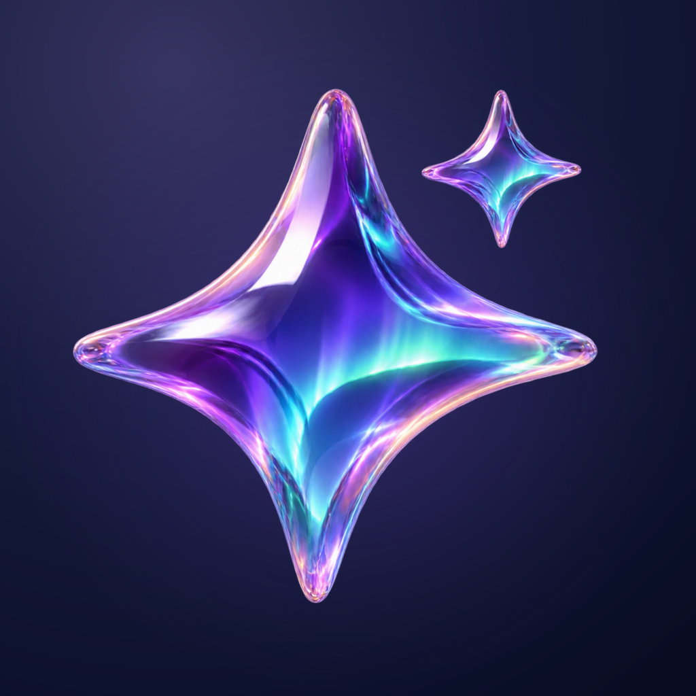
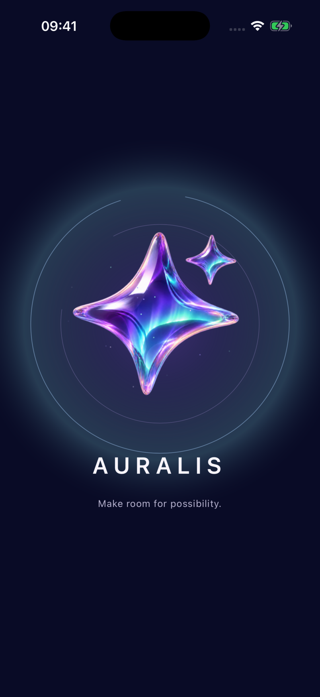
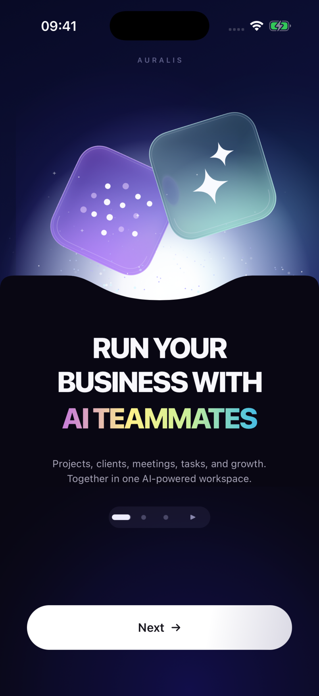
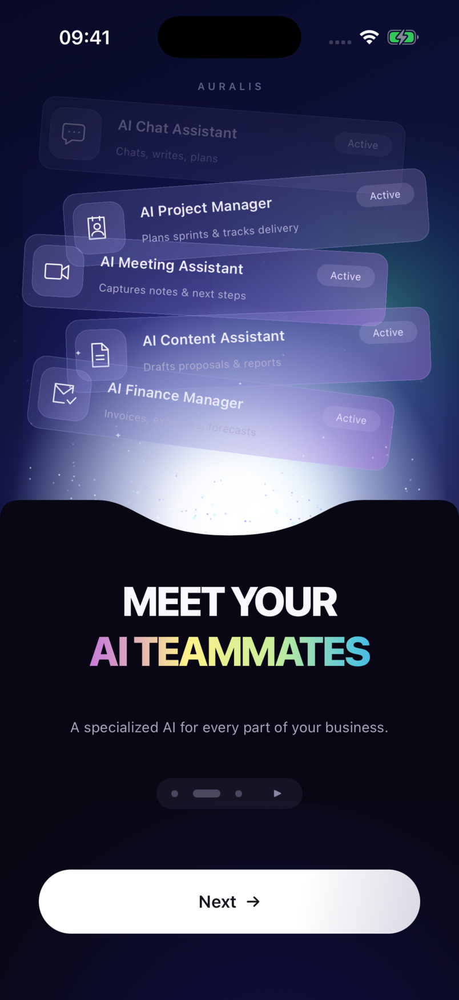
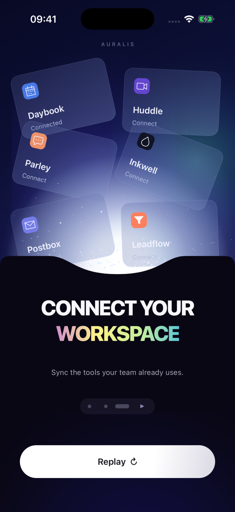

# Auralis



A cinematic onboarding experience built with **NativeScript-Vue** and **Jolt 0.1.0-rc.11**, featuring floating glass cards, animated gradients, and a timed carousel.

Floating glass tiles, a stack of AI teammates, and a constellation of connected tools. A pool of light ties the three scenes together, with drifting particles, tumbling transitions, and spectrum-colored native text.

<p align="center">
  
  
  
  
</p>

## Try it

Use Node **22.16 or later** and the NativeScript CLI. iOS requires macOS, Xcode, and CocoaPods; Android requires a configured Android SDK and JDK.

From the project directory:

```sh
nvm use
npm ci
npm run ios
```

For Android:

```sh
npm run android
```

The scripts use the Android SDK at `~/Library/Android/sdk` when available on macOS. The iOS wrapper also handles Homebrew's Ruby and CocoaPods paths without changing your shell configuration.

Pages advance automatically after **4 seconds** of reading time. The active capsule fills from left to right on the same Jolt clock that triggers the next page. Pause or resume with the control beside the page indicators.

Tap **Next**, swipe left or right, or choose a page indicator. **Replay** returns to the first scene. Manual navigation resets the reading time after the new scene settles. Repeated taps during a transition are ignored. Backgrounding freezes the countdown; returning resumes the remaining time. Autoplay starts paused when Reduce Motion or a screen reader is enabled. Change `CAROUSEL_DURATION` in `src/composables/useCarouselClock.ts` to adjust the interval.

## The motion

| Detail | Implementation |
| --- | --- |
| Launch sequence | Glass emblem, traced orbit paths, radial light wave, particles, and a Jolt timeline revealing the first scene |
| Glass hero tiles | Jolt `GlassView`, translucent gradients, and an inset highlight |
| Floating cards | Repeating native Jolt keyframes on an inner artwork container |
| Scene changes | Jolt timelines: cards tumble into the light, then launch upward and settle in staggered order |
| Aurora and light pool | Jolt radial and linear gradients |
| Dust and transition bursts | Jolt native particle emitters |
| Icons and curved horizon | Vector paths through `@rafaelaugusto/jolt/shapes` |
| Button feedback | Jolt `press()` |
| Page indicator and autoplay | Spring-driven active capsule; one Jolt motion value drives its fill and advances the carousel |
| Gradient lettering | Native text paint with a glyph mask and a Jolt-driven white light sweep on every entrance |
| Ownership and suspension | `motionScope()` for transitions, ambient motion, and resource cleanup |

The illustration is made of native views and vector paths. It does not play a video or embed a WebView. JavaScript coordinates scene changes; animation playback and particles run through Jolt's native implementations.

`GlassView` uses Liquid Glass on supported iOS versions and a blur fallback on earlier iOS versions. Android keeps the translucent gradient surfaces. The app follows the system Reduce Motion preference, including disabling particle effects and replacing spatial transitions with fades.

## Project structure

```text
src/
  App.vue                         Screen composition and safe-area measurements
  onboarding.ts                   Slide content, navigation, and responsive geometry
  components/
    OnboardingCopy.vue            Headings and supporting copy
    PageIndicator.vue             Accessible page controls and moving marker
    ContinueButton.vue            Next / Replay and press feedback
    LaunchScreen.vue              Responsive launch composition
  composables/
    useOnboarding.ts              Navigation state and transition coordination
    useCarouselClock.ts           Countdown, pause/resume, and autoplay ownership
  launch/
    launch-animation.ts           Orbit, light, emblem, and reveal choreography
  scene/
    artwork.ts                    Card builders and vector artwork
    choreography.ts               Drop and launch paths, timing, and overshoot
    aurora-view.ts                 Native scene and animation ownership
  native/
    gradient-title.ts              Native text paint, glyph masks, and entrance sheen
  assets/
    auralis-mark.png               Transparent launch emblem
resources/
  auralis-icon.png                 Composited app icon master
  branding/                       Source emblem and icon background
scripts/
  native.sh                       Local native toolchain setup
  check-versions.cjs               Checks the exact Jolt version
  generate-icons.py                Packages launcher and splash assets for both platforms
tests/
  onboarding.test.ts              Navigation and layout invariants
  choreography.test.ts            Card occlusion, launch paths, and stagger order
```

The outer card container handles scene transitions. Its inner artwork container handles the idle float. Keeping those transforms separate prevents one animation from replacing another and keeps the native drawing surfaces at stable bounds.

Each scene owns its animation handles and drawings. Shape controllers are disposed when the native view is destroyed; motion scopes suspend on app backgrounding and resume when the app returns.

The OS launch screen uses a static version of the emblem. Once NativeScript is ready, Jolt animates its orbit and the transition into the app. The title sheen captures only a glyph mask when text or layout changes; Jolt moves the light band natively, without repainting text from JavaScript on every frame. It replays even when adjacent pages use the same title.

## Make it yours

| Change | Start here |
| --- | --- |
| Headlines and descriptions | [`src/onboarding.ts`](src/onboarding.ts), `slides` |
| Page duration | [`src/composables/useCarouselClock.ts`](src/composables/useCarouselClock.ts), `CAROUSEL_DURATION` in milliseconds |
| Card timing and trajectories | [`src/scene/choreography.ts`](src/scene/choreography.ts) |
| Card artwork and content | [`src/scene/artwork.ts`](src/scene/artwork.ts) |
| Splash layout and motion | [`LaunchScreen.vue`](src/components/LaunchScreen.vue) and [`launch-animation.ts`](src/launch/launch-animation.ts) |
| Text spectrum and light sweep | [`src/native/gradient-title.ts`](src/native/gradient-title.ts) |
| App icon and launch emblem | [`resources/branding/`](resources/branding/) and `python3 scripts/generate-icons.py` |

## Checks

```sh
npm run check:versions
npm run typecheck
npm test
npm run build:ios
npm run build:android
```

Jolt is pinned to **`0.1.0-rc.11`** in the manifest, lockfile, and dependency override. `check:versions` also checks the installed package.

The unit tests cover forward/backward wraparound, layout clearance at several phone sizes, and the card trajectories. Departing cards must pass completely behind the curved horizon; incoming cards must settle without accumulating transforms. Native interaction checks and platform validation are recorded in [docs/validation.md](docs/validation.md).

The iOS build and interactions have been verified in the simulator. The Android bundle and resources compile; native Android rendering and physical-device performance still need device testing.

## Artwork

To regenerate the app icons and launch assets, install ImageMagick and librsvg, then run:

```sh
python3 scripts/generate-icons.py
```

iOS icons are opaque PNGs. Android includes legacy icons, an adaptive foreground, and a monochrome themed variant.

## Scope

Auralis is an onboarding and motion demo. Teammates, tools, and connection statuses are illustrative; the app does not create accounts or connect external services. All interface copy is in English. The supplied visual reference has no audio track, and this version is silent.

Built with [NativeScript](https://nativescript.org/), [NativeScript-Vue](https://nativescript-vue.org/), and [Jolt](https://jolt.rafaelaugusto.dev/).
